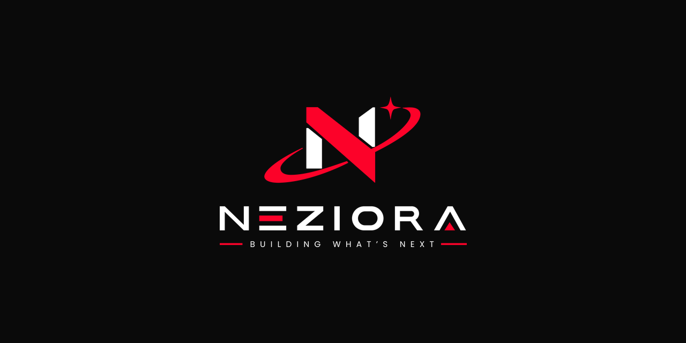
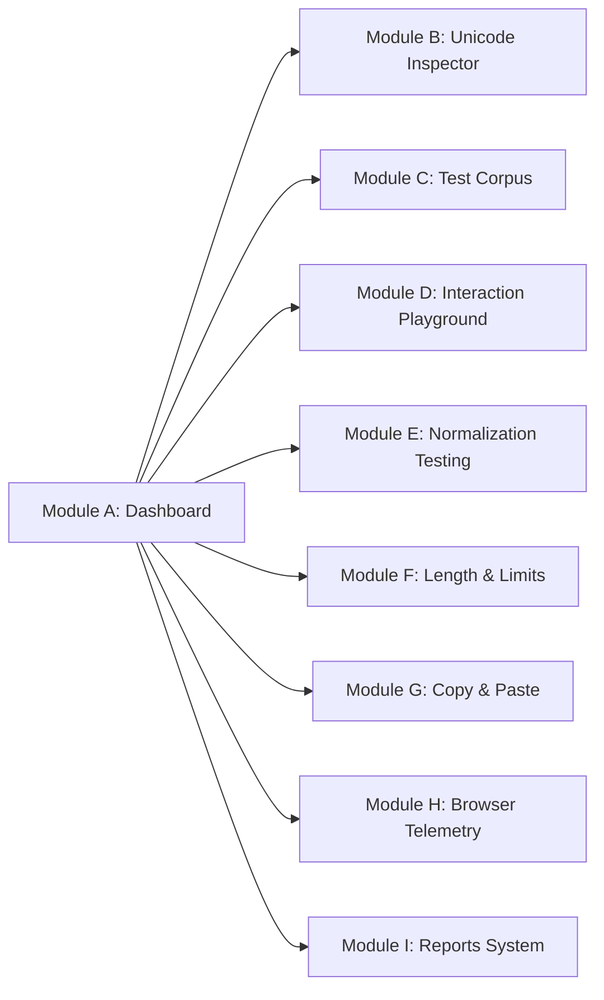

# SiWIT — Sinhala Web Interoperability Test Kit

<p align="center">
  
</p>

<p align="center">
  <strong>A developer-oriented testing toolkit for investigating, reproducing, documenting, and testing Sinhala text interoperability in modern web engines.</strong>
</p>

<p align="center">
  <a href="#attribution--ownership"></a>
  <a href="#attribution--ownership"></a>
  <a href="LICENSE"></a>
  <a href="#automated-testing"></a>
  <a href="#architecture"></a>
</p>

---

## 1. Introduction & Project Vision

**SiWIT (Sinhala Web Interoperability Test Kit)** is an open-source project initiated and led by **Uditha Manohara Prasad**, published under the **Neziora** brand. Its goal is to provide practical tools and reproducible test cases for investigating Sinhala text interoperability in web applications.

Sinhala is an Indic (Brahmic) script characterized by complex orthography:
- Combining dependent vowel signs (*Pili*) positioned above, below, before, or surrounding a base consonant.
- Pure consonants formed by suppressing inherent vowels using the *Al-lakuna* (virama `U+0DCA`).
- Orthographic ligatures formed with Zero-Width Joiners (`U+200D`), including **Yansaya** (`ක්‍ය`), **Rakaransaya** (`ක්‍ර`), **Repaya** (`ර්‍ය`), and **Bandiyakuru** conjuncts (`ක්ෂ`, `ණ්ඩ`, `ත්ත`).
- Prenasalized stop consonants (*Sannaka* `ඟ`, `ඳ`, `ඬ`, `ඹ`) requiring distinct handling from pure nasal sequences (`න්ග`, `න්ද`).

In modern web development, these characteristics frequently lead to critical interoperability bugs:
- **Input Truncation:** HTML `maxlength` cuts through multi-code-point sequences, leaving orphaned vowel signs or trailing ZWJ format controls.
- **Backspace & Delete Inconsistencies:** Browsers vary between deleting entire visual clusters vs decomposing code points one-by-one.
- **Caret Navigation & Selection Glitches:** Carets getting stuck inside invisible format characters.
- **Clipboard Degradation:** Rich text filters or OS clipboards stripping `U+200D`, causing ligatures to decompose into separated letters.
- **Normalization Desynchronization:** Discrepancies between composed NFC forms and decomposed NFD forms causing database index misses and failed string searches.

SiWIT provides software engineers, QA teams, font designers, and internationalization researchers with an empirical, reproducible test bench to isolate, verify, and resolve these behaviors.

---

## 2. Responsible Positioning & Prior Art

SiWIT builds upon established international standards and existing internationalization initiatives:
- **Unicode Standard 15.0/16.0** (Chapter 13: Sinhala block `U+0D80`–`U+0DFF`, UAX #15 Normalization, UAX #29 Segmentation).
- **SLS 1134:2011** (Sri Lanka Standard for Sinhala Character Code).
- **W3C Internationalization (i18n)** Working Group Sinhala Script Resources.
- **Mooniak Sinhala Font Testing & Tools** open-source projects.

SiWIT does not claim to be a new Unicode standard or a replacement for W3C tests. Instead, SiWIT provides an interactive, client-side testing workbench specifically focused on web application editing, form handling, clipboard fidelity, and DOM event flows.

---

## 3. Core Testing Modules



| Module | Identifier | Purpose |
|---|---|---|
| **Dashboard** | `Module A` | Real-time overview of test runs, engine capability checks, and quick navigation. |
| **Sinhala Unicode Inspector** | `Module B` | Decomposes text into code points, UTF-16 units, graphemes, and character names. |
| **Sinhala Test Corpus** | `Module C` | 29 curated, searchable test cases across 13 phonological categories. |
| **Interaction Playground** | `Module D` | Multi-surface editing (`input`, `textarea`, `contenteditable`) with live event stream logging. |
| **Unicode Normalization** | `Module E` | Side-by-side NFC, NFD, NFKC, and NFKD string comparison and sequence diff. |
| **Length & Input Limits** | `Module F` | Graphemes vs Code Points vs UTF-16 vs Bytes; live HTML `maxlength` simulator. |
| **Copy & Paste Testing** | `Module G` | Clipboard round-trip verification, permission handling, and ZWJ retention diff. |
| **Browser Environment** | `Module H` | Native API detection (`Intl.Segmenter`, `normalize`) and Sinhala font stack preview. |
| **Results & Reports** | `Module I` | Session results manager with JSON and Markdown export, and storage disclosure. |

---

## 4. Technology Stack & Zero-Dependency Architecture

SiWIT is engineered to run cleanly on modest hardware (e.g. Intel Core i3, 8GB–12GB RAM, integrated graphics) without build systems, heavy runtime dependencies, or compile steps:
- **Core Engine:** HTML5, Modern CSS3 (Custom Properties, Flexbox, Grid), Vanilla ES6+ JavaScript Modules.
- **Zero Frameworks:** No React, Next.js, Vue, Angular, or bundler build steps.
- **100% Client-Side Privacy:** Zero external network calls. User-entered text is processed in memory and never leaves the client browser.
- **Branding:** Strictly implements the 16-page official Neziora Brand Book (Neziora Red `#FC0229`, Neziora Black `#0A0A0A`, Graphite `#1A1A1A`, Steel Gray `#8A8A8A`, Light Gray `#F2F2F2`, White `#FFFFFF`) with official logo marks and typography (`Michroma`, `Sora`, `Inter`, `Jost`).

---

## 5. Getting Started & Local Execution

### 5.1 Clone Repository
```bash
git clone https://github.com/your-username/Neziora-SiWIT.git
cd Neziora-SiWIT
```

### 5.2 Run Local Static Server
Because modern browsers restrict ES module imports over the `file://` protocol, start a local HTTP server:

- **Using Node.js / npx:**
  ```bash
  npx serve .
  ```
- **Using Python 3:**
  ```bash
  python -m http.server 8080
  ```
- **Using PHP (built-in):**
  ```bash
  php -S localhost:8080
  ```

Open your browser to `http://localhost:3000` (or `http://localhost:8080`).

---

## 6. Automated Testing

SiWIT includes an automated unit test suite verifying deterministic Unicode calculations, normalization forms, grapheme counts, and test corpus schema integrity.

To execute the unit tests:
```bash
npm test
```
or directly with Node.js:
```bash
node tests/unit/run-tests.js
```

### Test Suite Status:
```
======================================================
   SiWIT — Automated Unit Test Suite
   Lead Engineer: Uditha Manohara Prasad
   Brand: Neziora
======================================================

--- Suite 1: Hex Formatting & Character Naming --- (5/5 Passing)
--- Suite 2: Code Point & Unit Extraction --- (7/7 Passing)
--- Suite 3: Length Calculations & Grapheme Clusters --- (7/7 Passing)
--- Suite 4: Normalization Comparisons --- (6/6 Passing)
--- Suite 5: Test Corpus Schema Validation --- (4/4 Passing)

Tests Completed: 29
Passed: 29
Failed: 0
```

---

## 7. Deploying to GitHub Pages

SiWIT is designed for static hosting on GitHub Pages:
1. Push the repository to GitHub:
   ```bash
   git add .
   git commit -m "feat: release v0.1.0 of Neziora SiWIT"
   git push origin main
   ```
2. Navigate to your repository on GitHub.
3. Go to **Settings** > **Pages**.
4. Under **Build and deployment** > **Source**, select `Deploy from a branch`.
5. Select the `main` branch and folder `/ (root)`, then click **Save**.
6. Within minutes, your site will be live at `https://<your-username>.github.io/Neziora-SiWIT/`.

---

## 8. Attribution & Ownership

- **Creator & Project Lead:** **Uditha Manohara Prasad**
- **Publishing & Supporting Brand:** **Neziora**
- **Attribution Statement:** Created and led by Uditha Manohara Prasad. Published under the Neziora brand.

> Neziora is the publishing and supporting brand. The individual creator, Uditha Manohara Prasad, conceptualized, architected, and engineered the project.

---

## 9. License

This project is open-source software licensed under the **[MIT License](LICENSE)**:

```
Copyright (c) 2026 Uditha Manohara Prasad
```

