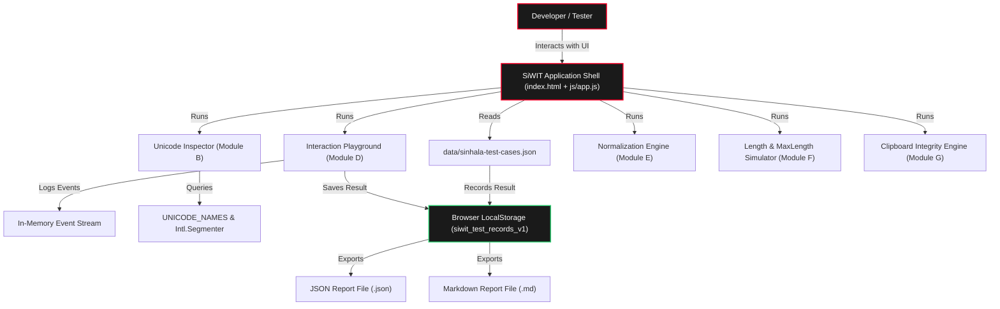

# SiWIT Architecture Specification

**Project:** SiWIT (Sinhala Web Interoperability Test Kit)  
**Created & Led by:** Uditha Manohara Prasad  
**Published under:** Neziora  
**Version:** 0.1.0  

---

## 1. Architectural Philosophy & Constraints

SiWIT is engineered with five strict architectural principles:
1. **Zero External Framework Overhead:** Pure HTML5, modern CSS3 (Custom Properties, Flexbox, Grid), and native ES6 JavaScript modules. No React, Next.js, Vue, or Webpack dependencies.
2. **Client-Side Privacy Guarantee:** 100% client-side text execution. User text never transmits over the network to any third-party analytics or server.
3. **Standards Grounding:** Built strictly atop established standards:
   - Unicode 15.0/16.0 (Chapter 13 South Asian Scripts: Sinhala U+0D80..U+0DFF)
   - Unicode Standard Annex #15 (Unicode Normalization Forms)
   - Unicode Standard Annex #29 (Unicode Text Segmentation)
   - Sri Lanka Standard 1134 (SLS 1134)
   - W3C Internationalization (i18n) Sinhala Script Recommendations
4. **Hardware Efficiency:** Designed to run smoothly on modest hardware (e.g. Intel Core i3, 8GB-12GB RAM, integrated graphics).
5. **Static Hosting Compatibility:** Fully compatible with GitHub Pages or any static HTTP file server.

---

## 2. Directory & Module Structure

```
Neziora-SiWIT/
├── index.html                   # Master application entry point
├── package.json                 # Optional npm scripts (type: module)
├── neziora_brand_guidelines.pdf # Authoritative 16-page Brand Book
│
├── assets/
│   └── logos/                  # Official Neziora logo marks and banners
│       ├── neziora-mark-dark-500x500.png
│       ├── neziora-mark-light-500x500.png
│       ├── neziora-full-dark-1280x640.png
│       ├── neziora-full-light-1280x640.png
│       ├── neziora-wordmark-dark-1128x191.png
│       ├── neziora-wordmark-light-1128x191.png
│       ├── neziora-og-dark-1200x630.png
│       └── neziora-og-light-1200x630.png
│
├── css/
│   ├── main.css                 # Brand CSS tokens, fonts, reset, typography
│   ├── layout.css               # Sidebar, topbar, view containers, footer
│   ├── components.css           # Buttons, cards, pills, tables, timeline
│   └── responsive.css           # Breakpoints for tablet, mobile, and print
│
├── js/
│   ├── app.js                   # Application router, state, theme manager
│   ├── modules/
│   │   ├── dashboard.js         # Module A: Overview & live metrics
│   │   ├── unicode-inspector.js # Module B: Code point decomposition & names
│   │   ├── corpus.js            # Module C: Test case repository & runner
│   │   ├── interaction-tests.js # Module D: Editing playground & event logger
│   │   ├── normalization.js     # Module E: NFC/NFD/NFKC/NFKD comparison
│   │   ├── length-tests.js      # Module F: Counting metrics & maxlength simulator
│   │   ├── clipboard-tests.js   # Module G: Clipboard API & round-trip diff
│   │   ├── browser-info.js      # Module H: Browser capabilities & font preview
│   │   └── reports.js           # Module I: Storage, JSON & Markdown export
│   │
│   └── utils/
│       ├── unicode.js           # Deterministic Unicode algorithms & names
│       ├── storage.js           # Privacy-first LocalStorage wrapper
│       └── dom.js               # Safe DOM helpers, escaping, toasts, download
│
├── data/
│   └── sinhala-test-cases.json  # Curated Sinhala test cases (29 cases)
│
├── tests/
│   ├── README.md                # Testing instructions
│   ├── unit/
│   │   └── run-tests.js         # Automated node test runner (29 tests)
│   └── browser/
│       ├── playwright.config.js # Optional E2E configuration
│       └── smoke.spec.js        # Optional E2E smoke tests
│
└── docs/
    ├── architecture.md          # Architecture specification (this file)
    ├── test-case-format.md      # Test case schema reference
    └── release-checklist.md     # Production release checklist
```

---

## 3. Data Flow & Security Model



1. **Input Isolation:** All user input remains in client memory. No remote HTTP endpoints are polled or called.
2. **DOM Safety:** All rendered text uses explicit DOM text nodes or `escapeHTML()` sanitization to guard against DOM-based XSS.
3. **Storage Transparency:** LocalStorage is used strictly for storing test results and theme preferences. A real-time byte counter and one-click "Clear All Records" button give users total control.

